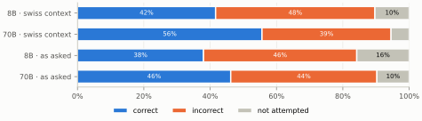
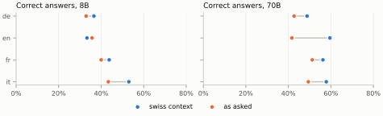
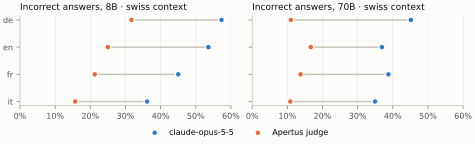

# Technical report — Swiss Newcomer QA: do Apertus models know the rules newcomers must follow?

> People who move to Switzerland must register, insure themselves and apply for permits within short deadlines, and increasingly ask chatbots how. We built 381 closed-book questions in German, French, Italian and English from the official portal ch.ch, each with accepted answers and a source, and graded Apertus 1.5 with SimpleQA. Even when told the user lives in Switzerland, Apertus 1.5 70B answers 39% of the questions wrongly and declines only 5%; grading itself, it would report 13%.

**Track:** Apertus Readiness - Track 1B (Swiss Voices, core task intelligence)  
**Event:** Online  
**Team:** Large Canelé Model — Yumeng Ye  
**Demo:** `make run` replays every model call and rebuilds the scores, figures, dataset card and this report; dataset: https://huggingface.co/datasets/YuYuYE/swiss-newcomer-qa

----

### Use of Apertus

- **Model:** `swiss-ai/Apertus-v1.5-8B` and `swiss-ai/Apertus-v1.5-70B`
- **How it is used:** evaluation (closed-book answers), dataset drafting (claude-opus-5-5, swiss-ai/Apertus-v1.5-70B wrote the candidate questions) and an in-harness judge
- **Where it runs:** hosted endpoint, CSCS Inference Service (`https://api.inference.cscs.ch/v1`), chat completions, server-side chat template, no system prompt
- **Other models:** Claude Opus 5.5, Sonnet 5.5 and Fable 5.1 (Anthropic) reviewed and adjudicated the candidates and graded the answers (Opus: primary grades). Claude also assisted with the code and with drafting this text; the team reviewed it.

----

## Use Case Description

A newcomer to Switzerland must register with the commune soon after arriving, take out health insurance within three months, and understand residence permits, the AHV/AVS pension system and withholding tax, often before speaking a national language well. ch.ch, run by the Federal Chancellery with the cantons, explains these rules in German, French, Italian and English. An assistant built on a Swiss model should give the same correct rules in all four languages, and should say when it does not know instead of inventing a deadline or an amount. The dataset measures exactly that: correct, incorrect and not-attempted answers to the questions a newcomer asks, per language and topic.

## Dataset Summary

Each regular item is a single-turn question with one short factual answer (deadline, amount, age, number, office, document or yes/no) that holds everywhere in Switzerland, is stated explicitly on the cited ch.ch page, and is written in the page's language in our own words. The 381 items cover 6 topics and come from 68 pages (one seed page per subject plus its official French, Italian and English versions), so every language has its own questions about the same procedures:

| topic | de | en | fr | it | all |
|---|---|---|---|---|---|
| health_insurance | 16 | 16 | 17 | 15 | 64 |
| naturalisation | 13 | 12 | 10 | 12 | 47 |
| pension | 27 | 23 | 21 | 23 | 94 |
| registration | 6 | 8 | 7 | 8 | 29 |
| residence_permit | 23 | 25 | 24 | 26 | 98 |
| withholding_tax | 12 | 13 | 11 | 13 | 49 |
| **all** | 97 | 97 | 90 | 97 | **381** |

52 items are edge cases, where the right answer is not a fact but a qualification:

| kind | de | en | fr | it | all |
|---|---|---|---|---|---|
| fact | 82 | 84 | 80 | 83 | 329 |
| cantonal | 8 | 6 | 2 | 7 | 23 |
| false_premise | 7 | 7 | 8 | 7 | 29 |

*cantonal* items ask as if there were one national rule where the page says it depends on the canton or commune; *false_premise* items take a wrong deadline, amount or obligation for granted, and the reference answer corrects it.

Items list 2.8 accepted answers on average (wording, units and number formats); 10 are tagged `dated` because the amount is revised over time. Metadata give each item's source URL, the page's modification date, the date it was checked (2026-10-06), the review votes and the licence.

## Data Collection Method

1. **Fetch and draft.** We fetched the pages (2026-10-06) and asked claude-opus-5-5, swiss-ai/Apertus-v1.5-70B (temperature 0.0) for up to 10 questions per page, each with an answer, variants and the passage it relies on. Page text stays local: ch.ch content may not be republished.
2. **Three blind AI reviews.** Claude Fable 5.1, Claude Opus 5.5, Claude Sonnet 5.5 each judged all 387 candidates as keep, edit or drop against our annotation guidelines (`docs/annotation-guidelines.md`: a newcomer would ask it, it stands alone, one short answer, stated explicitly in the passage, valid in every canton, every variant correct on its own). The drafting model never reviews. Agreement: Fleiss' kappa 0.642.
3. **Outcome rule and adjudication.** Unanimous keep: kept (168); majority drop: removed (54); everything else (165) went to Claude Opus 5.5, which re-checked the passage and wrote the final item (157 edited, 4 kept, 4 dropped), so that one reviewer who spots an error is not outvoted.
4. **Automatic checks.** The question must be in its page's language (py3langid) and must not copy 8 or more consecutive words from the passage; 19 questions were reworded.
5. **Edge cases.** Claude Opus 5.5 drafted cantonal items from the 29 passages that say a rule varies by canton or commune, and false-premise items from 32 regular items sampled evenly across topics; Claude Sonnet 5.5 reviewed each draft blind against the passage and kept 52. French has fewer cantonal items: several French passages say a rule varies "case by case", not by canton.

No human reviewed the items one by one, and no people took part as subjects; no consent was required. A consent form for future human graders is in `docs/annotator-consent-template.md`. Every vote and outcome, including the dropped candidates, is published in `review_log.jsonl`.

## Dataset Details

- **Hugging Face:** https://huggingface.co/datasets/YuYuYE/swiss-newcomer-qa (card generated from the data, `docs/dataset_card.md`)
- **Licence:** questions, answers, metadata, responses and grades under CDLA-Permissive-2.0; each metadata line carries its licence.
- **Copyright of the source:** ch.ch text is © Swiss Federal Chancellery and is not reproduced; we publish facts, our own wording and links. The copy check above enforces this.
- **Personal data:** none; the items describe procedures, not people.
- **Files:** `test_cases.jsonl` (items), `responses.jsonl` (model responses with grades), `metadata.jsonl`, `review_log.jsonl`; the dataset card (`docs/dataset_card.md`, generated from the data) documents every field.
- **Versioning:** the Git commit of this report fixes the dataset, the recordings and the grades.

## Evaluation

### Method

Every item is asked closed-book to both models in two conditions: **swiss_context** puts "I live in Switzerland." (in the item's language) before the question, as a newcomer would; **as_asked** asks the bare question. Many questions do not name the country, and without the sentence the models often answer for another country, especially in English.

Answers are graded with SimpleQA's three-way scheme (correct / incorrect / not attempted) and its unchanged grader prompt, and we report SimpleQA's metrics: the three rates, accuracy given attempted and F1. Our first grader was Apertus 70B, the only judge on the endpoint. To check it without a human annotator, Claude Opus 5.5 and Sonnet 5.5 graded the same seeded 20% sample blind (ids hidden, no model names):

| comparison | n | agreement | Cohen's kappa |
|---|---|---|---|
| judge vs claude-opus-5-5 | 1524 | 71.8% | 0.541 |
| judge vs claude-sonnet-5-5 | 154 | 72.7% | 0.534 |
| claude-opus-5-5 vs claude-sonnet-5-5 | 154 | 93.5% | 0.889 |

The two Claude graders agree with each other (kappa 0.89 on the sample) far more than with the Apertus judge, which accepted answers that contradict the reference (for example "10 years" for "5 years", ages 10–20 for 8–18). The headline grades are therefore claude-opus-5-5's, applied to all responses; the Apertus judge's grades stay in the dataset for comparison and for models we have not graded offline.

### Evaluation setup and inference parameters

Answers: temperature 0.0, at most 512 tokens, one sample per item and condition. Apertus judge: swiss-ai/Apertus-v1.5-70B, temperature 0.0, 16 tokens. All calls are recorded with their parameters and replayed by `make run`.

### Results

*Figure 1. Share of correct, incorrect and not-attempted answers, graded by claude-opus-5-5.*

| model/condition | correct | incorrect | not attempted | correct given attempted | F1 |
|---|---|---|---|---|---|
| 8B/swiss_context | 41.6% [36.4%, 47.0%] | 48.0% [42.7%, 53.4%] | 10.3% | 46.4% | 0.439 |
| 70B/swiss_context | 55.6% [50.2%, 60.9%] | 38.9% [33.8%, 44.3%] | 5.5% | 58.8% | 0.572 |
| 8B/as_asked | 38.0% [32.9%, 43.3%] | 46.2% [40.9%, 51.6%] | 15.8% | 45.1% | 0.413 |
| 70B/as_asked | 46.2% [40.9%, 51.6%] | 44.1% [38.8%, 49.5%] | 9.7% | 51.2% | 0.486 |

In brackets: 95% Wilson interval over the items.

Both models answer wrongly far more often than they decline: with the country stated, the 70B model is wrong on 39% of the items and declines 5%; the 8B model is wrong on 48%. For a newcomer, a confident wrong deadline is worse than "I don't know".

By item kind (country stated):

| model/condition | kind | n | correct | incorrect | not attempted |
|---|---|---|---|---|---|
| 8B/swiss_context | cantonal | 23 | 91.3% [73.2%, 97.6%] | 8.7% [2.4%, 26.8%] | 0.0% |
| 8B/swiss_context | fact | 329 | 41.6% [36.4%, 47.0%] | 48.0% [42.7%, 53.4%] | 10.3% |
| 8B/swiss_context | false_premise | 29 | 10.3% [3.6%, 26.4%] | 86.2% [69.4%, 94.5%] | 3.4% |
| 70B/swiss_context | cantonal | 23 | 95.7% [79.0%, 99.2%] | 4.3% [0.8%, 21.0%] | 0.0% |
| 70B/swiss_context | fact | 329 | 55.6% [50.2%, 60.9%] | 38.9% [33.8%, 44.3%] | 5.5% |
| 70B/swiss_context | false_premise | 29 | 20.7% [9.8%, 38.4%] | 75.9% [57.9%, 87.8%] | 3.4% |

The edge-case sets are small, so their intervals are wide: their direction, not the exact percentage, is the finding.

The two kinds of edge case split sharply. When a rule depends on the canton, the 70B model says so in 96% of the items, but this is partly a habit: it also says a rule differs by canton in 30% of its replies to regular facts, which are national. When the question rests on a false premise, it rejects the premise in only 21% and goes along with it in 76% (8B: 86%): a newcomer who already believes a wrong deadline or amount is likely to have it confirmed.

*Figure 2. Correct answers per language with and without "I live in Switzerland."*

Stating the country helps the 70B model most in English, from 42% to 60% correct: asked in German or French, it already assumes Switzerland; asked in English, it does not. The 8B model changes less and not in the same direction in every language (English even drops), so most of its errors are missing knowledge rather than a wrong country.

*Figure 3. Incorrect answers per language as graded by claude-opus-5-5 and by the Apertus 70B judge.*

Graded by itself, Apertus would look much better: the judge reports 13% incorrect for the 70B model instead of 39%. The gap is not the same in every language: in German the judge reports 11% incorrect where claude-opus-5-5 finds 45%, in English 17% against 37%. With the Apertus judge, German would look like the model's strongest language; with claude-opus-5-5 it is its weakest, so per-language comparisons made with a self-judge are misleading.

## Dataset Limitations

- **AI-only curation and grading.** Models drafted, reviewed, adjudicated and graded the items; the agreement figures bound but do not remove shared errors. There is no human judge–grader agreement.
- **Closed-model primary grader.** Results for new models need either the same offline grading or the Apertus judge with the bias shown above.
- **Coverage.** 6 topics; cantonal rules appear only as "it depends" edge cases, not with each canton's answer; no Romansh or Swiss German; one snapshot of the rules (2026-10-06).
- **Contamination.** ch.ch is public and likely in Apertus's training crawl; the questions are new text but the facts are not, so the set measures recall of official public information.
- **Generator bias.** Apertus drafted the questions; the reviewers and the primary grader are a different model family.

## Lessons Learnt and Recommendations

- **Do not let the model grade itself.** The Apertus judge put the 70B model's error rate at 13% instead of 39%; a second, independent grader on a sample is cheap and changes the conclusion.
- **State the context the user has.** Without "I live in Switzerland" the benchmark partly measures which country the model assumes, which differs by language.
- **Next for the dataset:** more edge cases (rules that changed recently, questions ch.ch does not answer), a human check of a sample of grades, cantonal ground truth for the largest cantons, and a dated re-fetch to track rule changes.
- **For Apertus:** prefer "I don't know" or a pointer to the competent office over a guessed figure; in a Swiss deployment, assume Swiss rules in English as it already does in German and French; align with ch.ch-style official information, which is freely readable.

## Reproducibility

- **Run:** `make run` from `track_1b/` (Docker, no API key, CPU only). It replays the recorded calls in `data/recordings/`, recomputes every score from `data/dataset/responses.jsonl` and the committed grades, **fails if the result differs from `results/scores.json`**, and rewrites the dataset card, the figures and this report. `make test` runs the tests.
- **New model:** add it to `models` in `data/eval.yaml` and run `make evaluate` with `LLM_API_KEY` in `.env`; its answers are recorded and graded by the Apertus judge, and can be graded offline with the same SimpleQA rules for headline numbers.
- **Determinism:** answers and judge use temperature 0 and are replayed exactly; the dataset build (`make build-dataset`) needs the local page text, which is not redistributed.

## License

Creative Commons Attribution 4.0 (CC-BY-4.0). Code: Apache-2.0. Dataset: CDLA-Permissive-2.0.

## References

- Wei et al., *Measuring short-form factuality in large language models* (SimpleQA), 2024. https://arxiv.org/abs/2411.04368; grader prompt from https://github.com/openai/simple-evals (MIT).
- ch.ch, the Swiss authorities online. https://www.ch.ch
- Fleiss, *Measuring nominal scale agreement among many raters*, Psychological Bulletin, 1971.
- Cohen, *A coefficient of agreement for nominal scales*, Educational and Psychological Measurement, 1960.
